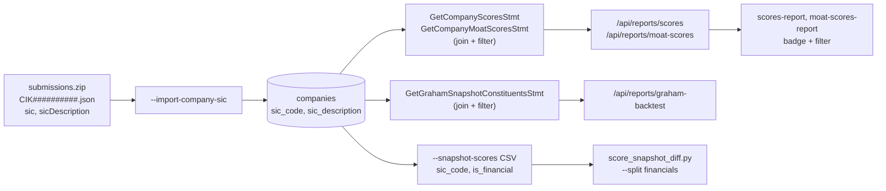

# SIC Industry Code and Financials Flag Requirements

> **Status (2026-11-22): Done.** All requirements are implemented (commits `1974b85`, `eb949fe`, `4f7c038`, `09ea244`, `fbb3860`, `a4b2aca`, `185e762`), V023 is applied and `--import-company-sic` has run on the 2026-11-22 data. ADR 0014 records the decision. Owner decisions in section 10. Owner decision 7 in the vault note *EDGAR Scoring Bug Fix Plan* (section 4.6): add an industry field from the EDGAR submissions data and show financials with a flag or filter on the results pages, excluding nothing from scoring. Spec 9.22 in the same note.

## Table of Contents

- [[#1. Summary|1. Summary]]
- [[#2. Requirements Table|2. Requirements Table]]
- [[#3. Kanban Task List|3. Kanban Task List]]
- [[#4. High-Level Design|4. High-Level Design]]
  - [[#4.1. High-Level Design - Data Flow|4.1. High-Level Design - Data Flow]]
  - [[#4.2. High-Level Design - Which SIC Codes Count as Financials|4.2. High-Level Design - Which SIC Codes Count as Financials]]
- [[#5. Technical Design|5. Technical Design]]
  - [[#5.1. Technical Design - Source Fields|5.1. Technical Design - Source Fields]]
  - [[#5.2. Technical Design - Migration|5.2. Technical Design - Migration]]
  - [[#5.3. Technical Design - Import Command|5.3. Technical Design - Import Command]]
  - [[#5.4. Technical Design - Classification|5.4. Technical Design - Classification]]
  - [[#5.5. Technical Design - Score Reads and Filter|5.5. Technical Design - Score Reads and Filter]]
  - [[#5.6. Technical Design - REST Endpoints|5.6. Technical Design - REST Endpoints]]
  - [[#5.7. Technical Design - Angular Pages|5.7. Technical Design - Angular Pages]]
  - [[#5.8. Technical Design - Backtest Filter|5.8. Technical Design - Backtest Filter]]
  - [[#5.9. Technical Design - Snapshot CSV and Diff Split|5.9. Technical Design - Snapshot CSV and Diff Split]]
- [[#6. Enabling the E6 and E5 Measurements|6. Enabling the E6 and E5 Measurements]]
  - [[#6.1. Enabling the E6 and E5 Measurements - E6 Sum-Over-Sum ROE|6.1. Enabling the E6 and E5 Measurements - E6 Sum-Over-Sum ROE]]
  - [[#6.2. Enabling the E6 and E5 Measurements - E5 Financing-Total Net Cash Flow|6.2. Enabling the E6 and E5 Measurements - E5 Financing-Total Net Cash Flow]]
- [[#7. Implementation Context|7. Implementation Context]]
- [[#8. Implementation Hints|8. Implementation Hints]]
- [[#9. Known Limitations|9. Known Limitations]]
- [[#10. Owner Decisions|10. Owner Decisions]]
- [[#11. Glossary|11. Glossary]]

## 1. Summary

The value score (15 checks) and the moat score (13 checks) treat every company alike. For banks, insurers and other financials several inputs mean something else: deposits are financing flows that the net cash flow counts as cash generated (E5), debt and book value are the business itself, and capex is usually untagged. About 108 of the 259 companies at value 13+ on the 2026-11-22 data are financials.

This feature:
1. imports each company's **SIC code and description** from the EDGAR submissions bulk file we already download (`submissions.zip`);
2. stores them per company (migration V023);
3. classifies **financials** by a documented SIC range (section 4.2);
4. shows a **badge** and a **filter** (all / financials only / exclude financials) on the value and moat results pages;
5. adds the same filter to the backtest API and a financials column to the score snapshot CSV, so that E6 and E5 can be measured with financials split out (section 6).

**Nothing is excluded from scoring.** Scores, check results and stored score tables do not change; the flag is read at query time.

## 2. Requirements Table

| ID | Requirement | Description | Status | Notes |
| --- | --- | --- | --- | --- |
| 1 | Store SIC per company | Migration V023 adds `companies.sic_code` (int, null) and `companies.sic_description` (varchar(200), null), with column comments and an index on `sic_code`. | Done | Null means no SIC in the SEC file, or not yet imported. |
| 2 | Import SIC | New CLI command `--import-company-sic` reads `sic` and `sicDescription` from each `CIK##########.json` in `submissions.zip` and updates `companies`. Idempotent; re-runnable without reimporting submissions. | Done | Paginated `-submissions-NNN.json` files carry no SIC and are skipped. Empty `sic` → null. |
| 3 | Financials classification | One shared rule, `IndustryClassification.IsFinancial(int? sicCode)`: SIC 6000–6499. Null or any other code → not financial. | Done | Range decision in 4.2. The rule exists once in C#; SQL predicates and the frontend use its output, never a copy of the range. |
| 4 | SIC in value score rows | `GET /api/reports/scores` rows carry `sicCode`, `sicDescription` and `isFinancial`, read from `companies` by join. | Done | `company_scores` is not changed or rebuilt. |
| 5 | SIC in moat score rows | Same for `GET /api/reports/moat-scores`. | Done | |
| 6 | Financials filter (API) | Both endpoints accept `financials=only|exclude` (omitted = all). Filter applies before pagination and counts. | Done | `exclude` keeps companies with a null SIC. |
| 7 | Badge (UI) | The scores and moat-scores pages show a small "Financial" badge next to the company name, with the SIC code and description as tooltip. | Done | A shared `.badge-financial` class in `report-table.css` (plain hex colors, like the rest of the file). |
| 8 | Filter (UI) | A "Financials" select (All / Only financials / Exclude financials) beside the Exchange filter on both pages; kept in the CSV export rows. | Done | |
| 9 | Backtest filter (API) | `GET /api/reports/graham-backtest` accepts `financials=only|exclude`; constituents are filtered per snapshot date using the company's current SIC. | Done | Needed for the E6 and E5 measurements (section 6). Implemented in `GrahamBacktestService` (filters constituents via `GetCompanySics`), not in the constituents SQL. |
| 10 | Backtest filter (UI) | Same select on the `graham-backtest` page. | Done | Owner decision 4: build it. |
| 11 | Snapshot CSV columns | `--snapshot-scores` writes `sic_code` and `is_financial` as trailing columns in both CSVs. | Done | Trailing, so older CSVs still load. |
| 12 | Diff split | `scripts/score_snapshot_diff.py` gains `--split financials`: reports the change histogram, group entries/exits and check flips for financials and non-financials separately. | Done | Takes the flag from the newer file; companies without it count as non-financial. |
| 13 | No score change | Snapshot diff before and after the feature is empty on scores and check results. | Done | Snapshot `…-a4b2aca-sic-s6-*` equals the stored score tables for all 14,041; `…-sic-baseline-*` (with SIC) diffs empty against it. |
| 14 | Tests | xUnit for parsing, classification, the update statement (in-memory), score and backtest filters; Angular specs for the badge and filter. | Done | In-memory `IDbmService` doubles; no DB in tests. |
| 15 | Docs | ADR 0014 (SIC financials flag: source, range, alternatives); reimport runbook gains the new step; this document's statuses. | Done | |

## 3. Kanban Task List

Each task is at most about 2 hours. Vault first: each task's spec goes into the plan's section 9 before code, and each commit gets a 1.6 progress row.

**Done** (2026-11-22)
- [x] **T1 Migration (0.5 h).** `V023__AddSicToCompanies.sql`: two columns, comments, `idx_companies_sic_code`. Note: the first app start after this commit applies it.
- [x] **T2 Parse and classify (1 h).** `SubmissionsCompanyHeader` record (`cik`, `sic`, `sicDescription`) in `Stocks.DataModels/EdgarFileModels`; `IndustryClassification` with `FinancialSicMin = 6000`, `FinancialSicMax = 6499`, `IsFinancial(int?)` and `ParseSic(string?)`. Tests: Apple 3571 → not financial; 6021, 6331, 6411 → financial; 6798, 6770, 6500 → not; "" and null → null; non-numeric → null.
- [x] **T3 Update statement (1.5 h).** `UpdateCompanySicBatchStmt` (`NonQueryBatchedDbStmtBase`, `UPDATE companies SET sic_code, sic_description WHERE company_id`); `IDbmService.UpdateCompanySic(IReadOnlyCollection<CompanySic>, ct)` in `DbmService` and `DbmInMemoryService`/`DbmInMemoryData`. Read side: `Company` gains optional `SicCode`/`SicDescription`, or a separate `GetCompanySicStmt` (decide while coding, prefer the smaller change). Tests in-memory.
- [x] **T4 CLI command (1.5 h).** `--import-company-sic` in `Program.cs`: CIK → company id map from `GetAllCompaniesByDataSource`, enumerate the zip, skip `-submissions-` files, batch updates of 5,000, log counts (files, with SIC, matched, unmatched). `run.sh` menu entry. Test: a small in-memory zip with three files (SIC, empty SIC, paginated) → two updates, one null.
- [x] **T5 Score reads (2 h).** `GetCompanyScoresStmt` and `GetCompanyMoatScoresStmt`: `LEFT JOIN companies c USING (company_id)`, select `c.sic_code, c.sic_description`; `ScoresFilter` / moat filter gain `FinancialsFilter Financials` (`All`, `Only`, `Exclude`) → `c.sic_code BETWEEN @fin_min AND @fin_max` or its negation with `IS NULL`. `CompanyScoreSummary` and `CompanyMoatScoreSummary` gain trailing optional `int? SicCode = null, string? SicDescription = null` and a computed `IsFinancial`. In-memory mirror. Tests: filter only/exclude/all, null SIC under exclude, total count follows the filter.
- [x] **T6 Endpoints (1 h).** Parse `financials` on `/api/reports/scores` and `/api/reports/moat-scores`; unknown values → all. Endpoint tests if the project has them, else statement-level tests from T5 cover it.
- [x] **T7 Angular (2 h).** `api.service.ts` models and params; `scores-report` and `moat-scores-report`: badge, tooltip, filter select, CSV export columns; `.badge-financial` in `shared/styles/report-table.css`. Specs: badge shown only when `isFinancial`, filter sends the param and resets to page 1. `ng build` clean, `ng test` green.
- [x] **T8 Backtest filter (2 h).** As built: `GrahamBacktestService` filters the constituents with `GetCompanySics` (the constituents statement is unchanged); `GrahamBacktestService.GetBacktest` and the endpoint pass it through; the cache key (if any) includes it. Tests: a financial 15/15 constituent drops out under `exclude`, is alone under `only`; monthly chaining unchanged.
- [x] **T9 Backtest UI (1 h).** Select on the `graham-backtest` page; spec.
- [x] **T10 Snapshot CSV and diff split (1.5 h).** `ScoreSnapshotCsv` trailing `sic_code,is_financial`; the snapshot path reads them from the T3/T5 source; `score_snapshot_diff.py --split financials`. Test: CSV header and a row; a script self-test on two tiny CSVs if the script has one, else a scratch run documented in the progress row.
- [x] **T11 Data step (0.5 h, owner approval).** Run `--import-company-sic` on the real DB (it applies V023 first). Verify: 74,208 companies with a SIC; of the 14,041 scored, 13,841 with a SIC and 1,836 financial; spot checks AAPL 3571, BAC 6021, BRK-B 6331. Then a snapshot and a diff against the last one: scores identical (requirement 13).
- [x] **T12 Docs (1 h).** ADR 0014 and its `decisions/README.md` line; the reimport order (new step after step 3); `project_fact_sheet.md` if it lists the data fields; this document's statuses (ask the owner first).

**Backlog / Ready / In Progress:** empty.

## 4. High-Level Design

### 4.1. High-Level Design - Data Flow



The SIC lives on `companies`, not in the score tables. Every read joins it, so the flag needs no score rebuild, applies to all 61 stored backtest dates at once, and a reclassified company moves everywhere on the next import. The cost is that a past snapshot uses today's SIC (section 9).

### 4.2. High-Level Design - Which SIC Codes Count as Financials

Measured 2026-11-22 (read-only): a scan of the 994,026 company files in `submissions.zip` joined to the 14,041 scored companies. All scored companies have a file; 13,841 have a SIC.

| SIC range | Industry | Scored | Value 13+ | Value 15/15 | Moat 11+ | Financial? |
| --- | --- | ---: | ---: | ---: | ---: | --- |
| 6000–6099 | Depository institutions (banks, savings institutions) | 907 | 72 | 10 | 0 | **Yes** |
| 6100–6199 | Non-depository credit (consumer, business, mortgage lenders, ABS issuers) | 290 | 8 | 1 | 0 | **Yes** |
| 6200–6299 | Security and commodity brokers, dealers, exchanges, advisers | 378 | 8 | 0 | 8 | **Yes** |
| 6300–6399 | Insurance carriers | 223 | 19 | 3 | 1 | **Yes** |
| 6400–6499 | Insurance agents and brokers | 38 | 1 | 0 | 0 | **Yes** |
| 6500–6599 | Real estate operators, agents, developers | 303 | 2 | 0 | 1 | No |
| 6798 | Real estate investment trusts | 498 | 6 | 0 | 0 | No |
| 6770 | Blank checks (SPACs) | 1,100 | 0 | 0 | 0 | No |
| 6700–6799 other | Patent owners, royalty traders, investors NEC | 77 | 0 | 0 | 1 | No |
| other | Non-financial | 10,027 | 143 | 18 | 96 | No |
| none | No SIC in the file | 200 | 0 | 0 | 0 | No |
| **Financial total** | **6000–6499** | **1,836** | **108 of 259** | **14 of 32** | **9 of 107** | |

**Decision proposed: financial = SIC 6000–6499.** These are the companies whose balance sheet is the business: deposits, loans, float and dealer inventories. They are where the scoring inputs stop meaning the same thing (E5 deposit flows, D/E and book value, no capex tag, E3).

Left out, each a documented alternative for the owner:
- **REITs (6798) and real estate (65xx):** since 2016 a separate sector, not financials, in the common sector schemes. Their scoring issues (development spend not capex, E3; high leverage) are about real assets, not deposits or float. Adding them would bring 801 scored companies and 8 of the 13+ group. If wanted, a second flag "Real estate" is cleaner than widening "Financial".
- **Blank checks (6770):** 1,100 scored, none at 13+, so no effect on the groups that matter. A later "Shell/SPAC" flag could hide them.
- **Other 67xx:** patent and royalty vehicles; not lenders or insurers.
- **The SEC's `ownerOrg` ("02 Finance"):** names the SEC review office, not the industry, and the office split changes over time; SIC is the stable public code.

## 5. Technical Design

### 5.1. Technical Design - Source Fields

Checked in real files from the 2026-11-22 `submissions.zip`:

| File | `sic` | `sicDescription` | `ownerOrg` |
| --- | --- | --- | --- |
| `CIK0000320193.json` (Apple) | `"3571"` | Electronic Computers | 06 Technology |
| `CIK0000070858.json` (Bank of America) | `"6021"` | National Commercial Banks | 02 Finance |
| `CIK0000072971.json` (Wells Fargo) | `"6021"` | National Commercial Banks | 02 Finance |
| `CIK0001067983.json` (Berkshire Hathaway) | `"6331"` | Fire, Marine & Casualty Insurance | 02 Finance |

- Top-level JSON properties, before `filings`. `sic` is a **string** (four digits); `""` when missing. 74,208 of 994,026 files have one (most CIKs are individuals and funds that never file a 10-K).
- `cik` is a zero-padded string in these files. The existing `RecentFilingsContainer` reads it as `ulong` through `Conventions.DefaultOptions`; reuse those options.
- `CIK##########-submissions-NNN.json` files hold only older filings, with no company fields.

### 5.2. Technical Design - Migration

```sql
-- V023__AddSicToCompanies.sql
ALTER TABLE companies ADD COLUMN sic_code int;
ALTER TABLE companies ADD COLUMN sic_description varchar(200);
CREATE INDEX idx_companies_sic_code ON companies (sic_code);
COMMENT ON COLUMN companies.sic_code IS 'SEC Standard Industrial Classification code from the EDGAR submissions file (sic); null when the SEC lists none or before --import-company-sic.';
COMMENT ON COLUMN companies.sic_description IS 'SEC description of sic_code (sicDescription).';
```

`BulkInsertCompaniesStmt` (step 2) leaves them null; it uses explicit column lists, so no change. A reimport drops and refills `companies`, so the import command must run after step 2 each time.

### 5.3. Technical Design - Import Command

`--import-company-sic` in `Stocks.EDGARScraper/Program.cs`, modelled on `ParseBulkEdgarSubmissionsList`:
1. Load the CIK → company id map (`GetAllCompaniesByDataSource`).
2. For each `.json` entry that does not contain `-submissions-`: deserialize `SubmissionsCompanyHeader`; parse `sic` with `IndustryClassification.ParseSic`; skip when the CIK has no company.
3. Add a `CompanySic(CompanyId, SicCode, SicDescription)` record to the batch, including null SIC (so a re-run clears a removed code). Flush every 5,000 through `IDbmService.UpdateCompanySic`.
4. Log files read, with SIC, unmatched CIKs, rows updated. Return `Result`; per-file failures are logged and skipped, like step 3.

Reimport order: a new step right after step 3 (`--parse-bulk-edgar-submissions-list`); it reads the same zip. Expected run time: one pass over the zip, like step 3 without the inserts.

Alternative considered: parse the SIC inside step 3. Rejected because step 3 inserts submissions and is not re-runnable, so the existing DB could not be filled without a full reimport.

### 5.4. Technical Design - Classification

```csharp
// Stocks.DataModels/Scoring/IndustryClassification.cs (sketch)
public static class IndustryClassification {
    public const int FinancialSicMin = 6000;
    public const int FinancialSicMax = 6499;
    public static bool IsFinancial(int? sicCode) =>
        sicCode is int sic && sic >= FinancialSicMin && sic <= FinancialSicMax;
    public static int? ParseSic(string? raw) { /* trim; 1–4 digits → int; else null */ }
}
```

SQL statements pass the two constants as parameters (`@fin_min`, `@fin_max`), so the range is written once. `FinancialsFilter` enum: `All`, `Only`, `Exclude`.

### 5.5. Technical Design - Score Reads and Filter

- `GetCompanyScoresStmt` / `GetCompanyMoatScoresStmt`: `FROM company_scores s LEFT JOIN companies c ON c.company_id = s.company_id`; column references in WHERE and ORDER BY are qualified (both tables have `cik`).
- `Only` → `c.sic_code BETWEEN @fin_min AND @fin_max`; `Exclude` → `(c.sic_code IS NULL OR c.sic_code NOT BETWEEN @fin_min AND @fin_max)`.
- The total-count query uses the same FROM and WHERE.
- `CompanyScoreSummary` and `CompanyMoatScoreSummary`: trailing `int? SicCode = null, string? SicDescription = null`, plus `public bool IsFinancial => IndustryClassification.IsFinancial(SicCode);` (serialized as `isFinancial`). The bulk inserts ignore the new fields; the score services never set them.
- `DbmInMemoryData` joins its companies list the same way.

### 5.6. Technical Design - REST Endpoints

- `GET /api/reports/scores?...&financials=only|exclude`
- `GET /api/reports/moat-scores?...&financials=only|exclude`
- `GET /api/reports/graham-backtest?...&financials=only|exclude`

Parsed case-insensitively; anything else is `All`. Row JSON gains `sicCode`, `sicDescription`, `isFinancial`.

### 5.7. Technical Design - Angular Pages

- `api.service.ts`: the two row interfaces gain `sicCode: number | null; sicDescription: string | null; isFinancial: boolean`; the two request param types gain `financials: 'only' | 'exclude' | null`.
- `scores-report` and `moat-scores-report`: a `Financials` select after `Exchange` (All / Only financials / Exclude financials), wired like `exchange` (`onFilterChange()` → page 1). In the company cell, `@if (row.isFinancial) { <span class="badge-financial" [title]="row.sicCode + ' ' + row.sicDescription">Financial</span> }`.
- `shared/styles/report-table.css`: `.badge-financial` using existing CSS variables (muted accent, small caps, mono size).
- The CSV export already takes `items()`; the new fields come along.

### 5.8. Technical Design - Backtest Filter

`GetGrahamSnapshotConstituentsStmt` (`FROM graham_score_snapshots WHERE overall_score >= @min_score`) joins `companies` and adds the same predicate. `GrahamBacktestService.GetBacktest(minScore, interval, policy, confirm, financials, ct)` passes it through; nothing else in the chaining changes. The benchmark (SPY) is unaffected.

### 5.9. Technical Design - Snapshot CSV and Diff Split

- `ScoreSnapshotCsv`: `sic_code,is_financial` appended to both headers and rows (`is_financial` as `1`/`0`).
- `score_snapshot_diff.py a.csv b.csv value|moat [--split financials]`: without the flag, output is unchanged. With it, the report is printed three times: all, financials, non-financials. The flag comes from file b; rows missing the column count as non-financial.

## 6. Enabling the E6 and E5 Measurements

Both were measured in M1 on the 2026-08-23 data with financials mixed in (plan sections 4.6 and 4.7). The owner deferred them until financials can be seen separately. With this feature, each is measured the same way, before going live.

### 6.1. Enabling the E6 and E5 Measurements - E6 Sum-Over-Sum ROE

Owner decision: adopt E6 (ROE = Σ numerator ÷ Σ average equity, CF numerator = NCF + dividends) after the flag, measured with financials split out and backtested before and after.
1. Land this feature; confirm requirement 13 (empty diff).
2. Implement E6 test-first (its own spec in the plan). Snapshot; diff against the post-feature snapshot with `--split financials`. M1 showed 15/15 doubling (30 → 60), with insurers and banks among the entrants; the split shows how much of that is financials.
3. **Backtest before:** `graham-backtest` at 15/15 (and 14+) with `financials` = all, exclude, only, on the current 61 snapshot dates. Record total and annualized return vs SPY and average constituents.
4. **Backtest after:** back up `graham_score_snapshots` (`pg_dump -t`), rebuild the 61 dates with the E6 build (`--compute-score-snapshots`, about 2 h; a DB write, owner approval), run the same six backtests. If E6 is rejected, restore the backup.
5. Report the before/after table per segment in the plan; the owner decides.

### 6.2. Enabling the E6 and E5 Measurements - E5 Financing-Total Net Cash Flow

E5 (NCF = Δcash − financing total − dividends) removes bank deposit flows but changes NCF for everyone (NCI distributions, lease principal, tax withholding). With the split:
- the diff shows whether E5's 4,261 moved scores are mostly financials (deposit flows) or spread across non-financials (the meaning change);
- the backtest shows whether the bank exits from 13+ (AX BANF BOKF BPOP CATY in M1) help or hurt;
- if the change is confined to financials, a further option opens: financing-total NCF **for financials only**. That would break "exclude nothing / treat everyone alike" and needs its own owner decision; it is not part of this feature.
- **Owner direction (2026-11-22):** consider E5 after the measurements; the owner expects that net cash flow needs a different definition for financials than for other companies. So the E5 measurement compares, per segment, chain-based NCF against financing-total NCF, and the follow-up spec should include the financials-only variant.

The cash-flow identity check recommended in 4.6 still comes first.

## 7. Implementation Context

- Submissions import (model for the new command): `dotnet/Stocks.EDGARScraper/Program.cs`, `ParseBulkEdgarSubmissionsList` and `GetFilingsDetails`.
- Submissions JSON models: `dotnet/Stocks.DataModels/EdgarFileModels/RecentFilings.cs` (`RecentFilingsContainer` reads `cik`).
- Company model: `dotnet/Stocks.DataModels/Company.cs` (`Company(CompanyId, Cik, DataSource, Instruments)`).
- Companies table: `dotnet/Stocks.Persistence/Database/Migrations/V001__CreateTables.sql`; latest migration `V022__AddTitleToCompanyTickers.sql`.
- Batched update base class: `NonQueryBatchedDbStmtBase` (example `UpsertDataPointsBatchStmt.cs`).
- Score reads: `GetCompanyScoresStmt.cs` (`BuildSql` with `whereClauses`, `exchange` filter as the model), `GetCompanyMoatScoresStmt.cs`; filter record `ScoresFilter(MinScore, MaxScore, Exchange)` in `Stocks.DataModels/Scoring/ScoresReportRequest.cs`.
- Score rows: `Stocks.DataModels/Scoring/CompanyScoreSummary.cs` (trailing optional `CheckResults` is the precedent for optional fields).
- Endpoints: `dotnet/Stocks.WebApi/Endpoints/ReportEndpoints.cs`, `MoatReportEndpoints.cs`, `GrahamBacktestEndpoints.cs`.
- Backtest: `dotnet/Stocks.Persistence/Services/GrahamBacktestService.cs`, `GetGrahamSnapshotConstituentsStmt.cs`.
- In-memory doubles: `DbmInMemoryService.cs` (`GetCompanyScores` → `_data.GetCompanyScoresPaged`), `DbmInMemoryData.cs`.
- Snapshot tool: `dotnet/Stocks.EDGARScraper/Services/ScoreSnapshotCsv.cs`, `scripts/score_snapshot_diff.py`.
- Angular: `frontend/stocks-frontend/src/app/features/scores-report/`, `moat-scores-report/`, `graham-backtest-report/`; `core/services/api.service.ts`; `shared/styles/report-table.css`.
- Reimport runbook: the project memory note on reimport step ordering; `run.sh` menu.

## 8. Implementation Hints

- Explicit loops, no LINQ in production code; `Result` pattern; records instead of tuples; explicit usings.
- Measure with `--snapshot-scores` as usual. T1 adds a migration: until T11 is approved, measure from a scratch copy without `V023__*.sql`, so the snapshot does not apply it (the DB stays read-only).
- Qualify `cik` and `company_id` once the join is in place; the existing sort columns are unambiguous but `cik` is not.
- Keep `financials` out of the score services: they compute scores; the flag belongs to reads.
- The badge text is "Financial", not a verdict; the tooltip tells the reader why (SIC code and description).

## 9. Known Limitations

- **Today's SIC for past snapshots:** the backtest filter uses each company's current SIC. A company reclassified since an as-of date is filtered by its new code. Rare for the 6000–6499 range; accepted to avoid storing SIC per snapshot.
- **SIC is coarse and self-reported:** a few conglomerates file under a financial code (Berkshire Hathaway, 6331) and some fintechs under a non-financial one. The tooltip shows the code so the reader can judge.
- **200 scored companies have no SIC:** they count as non-financial and stay under "exclude".
- **Not every company is reclassified on re-import:** a company that drops out of `submissions.zip` keeps its last SIC.

## 10. Owner Decisions

Decided 2026-11-22.
1. **Range:** financial = SIC 6000–6499, as recommended. REITs, real estate and other 67xx codes are not flagged.
2. **Blank checks (6770):** left unflagged, as recommended.
3. **E5:** consider it after the measurements; the owner suspects net cash flow must be treated differently for financials (section 6.2). The company-header SIC display was not taken up and stays out of scope.
4. **Backtest UI select (T9):** build it.
5. **E6 after-run:** rebuild the 61 dates in place after a `pg_dump` backup of `graham_score_snapshots` (6.1 step 4).

## 11. Glossary

- **SIC (Standard Industrial Classification):** a four-digit US industry code. The SEC assigns one to each registrant and publishes it in the submissions file as `sic` and `sicDescription`.
- **Financial (in this project):** a company with SIC 6000–6499: banks and savings institutions, non-bank lenders, brokers and dealers, insurance carriers and agents.
- **Submissions file:** `submissions.zip`, the SEC's bulk export with one `CIK##########.json` per filer (company fields and recent filings) plus `-submissions-NNN.json` pages of older filings.
- **Badge:** a small label beside a company name on a results page.
- **Value score / moat score:** the 15-check Graham-style score (`ScoringService`) and the 13-check moat score (`MoatScoringService`); see ADR 0013.
- **NCF (net cash flow):** change in cash minus the debt, stock and preferred financing chains (ADR 0013); E5 would use the financing total instead.
- **E5, E6:** deferred scoring changes in the vault plan: financing-total NCF (E5) and Σ ÷ Σ ROE with average equity (E6).
- **Snapshot (score snapshot):** a CSV of every company's score and check results written by `--snapshot-scores`, compared with `score_snapshot_diff.py`. Not the same as a backtest snapshot date in `graham_score_snapshots` (ADR 0012).
- **Backtest:** the monthly-rebalance simulation over `graham_score_snapshots` (`docs/graham-backtest/requirements.md`).
